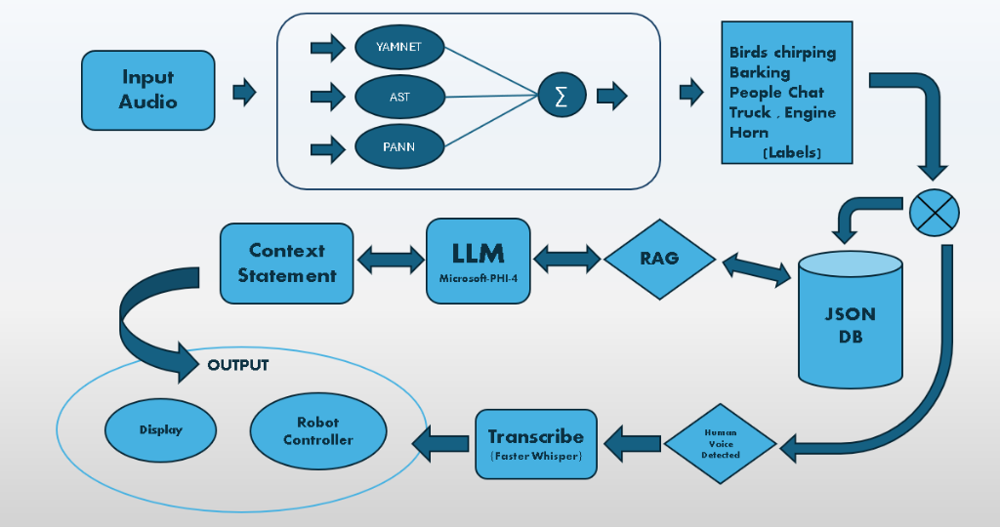

<div align="center">

# 🎙️ AudioSense
### *Audio Intelligence for Machines, Robots, and Modern Applications*

[](https://python.org)
[](https://pypi.org/project/audiosense/)
[](https://github.com/mohanevs/AudioSense)
[](https://github.com/mohanevs/AudioSense)
[](https://github.com/mohanevs/AudioSense)
[](LICENSE)

<p align="center">
  <a href="#-overview">Overview</a> •
  <a href="#-how-it-works-architecture">Architecture</a> •
  <a href="#-quickstart">Quickstart</a> •
  <a href="#-key-features">Key Features</a> •
  <a href="#-contributing">Contributing</a>
</p>

---

</div>

## 📌 Overview

Computers see really well (YOLO, OpenCV) and read text like pros (LLMs), but when it comes to raw sound, they've been mostly deaf. A camera might spot someone standing near a door, but it completely misses footsteps creeping up from around the corner, a window shattering in another room, or a faucet left overflowing.

**AudioSense** gives machines actual ears. It’s an audio perception library designed to turn raw acoustic signals into:

1. **Events** — *What just happened and when* (sound event classification & detection).
2. **Speech** — *What was spoken* (automatic VAD gating and transcription).
3. **Context** — *What it means in the real world* (LLM-driven situational reasoning).

Whether you're building an autonomous robot, smart security setup, home automation hub, or assistive device, AudioSense gives your application true situational awareness.

---

## 🏛️ How It Works (Architecture)

<div align="center">
  
</div>

<br/>

### The Acoustic Pipeline in 4 Steps:

1. **Input Sound Ingestion**: Takes audio from any format (`.wav`, `.mp3`, `.m4a`, etc.) or continuous live microphone streams.
2. **Multi-Model Consensus**: Runs sound through **YAMNet**, **AST** (Transformer), and **PANN** (CNN14) simultaneously. Predictions are combined into calibrated consensus labels (*Barking*, *Horn*, *Engine*, *Chat*) so you never rely on a single noisy model.
3. **The Intelligent Switcher**:
   - **Human Voice Detected?** Routes straight to **Faster-Whisper** for rapid speech transcription.
   - **Ambient Sounds?** Logged to the persistent **JSON Database**, paired with **RAG**, and passed to a local **LLM** (Microsoft-Phi-4) to generate an intuitive, human-like **Context Statement** (e.g., *"Kitchen faucet running while footsteps approach"*).
4. **Actionable Output**: Clean results delivered straight to your **Display UI** or **Robot Controller** to trigger real-time actions.

---

## ⚡ Quickstart

Install it with pip:

```bash
pip install audiosense
```

Give your code ears in 4 lines of Python:

```python
from audiosense import AudioSense

# 1. Initialize engine
sense = AudioSense()

# 2. Hear what's happening
result = sense.predict("environment.wav")

print(result)
# Output: Surroundings currently exhibit sounds of Water tap running, Sink filling.
```

---

## ✨ Key Features

- **Triple-Model Ensemble** — Combines AST, PANNs (CNN14), and YAMNet in a single pass with calibrated consensus scoring.
- **Intelligent Routing (Switcher)** — Automatic VAD gating routes human speech to Whisper and environmental sound to contextual reasoning.
- **Situational Intelligence (LLM + RAG)** — Doesn't just dump raw tags; synthesizes high-level situation reports via local LLMs (Phi-4-mini, Qwen, Ollama).
- **Live Mic Loop for Robotics** — Non-blocking streaming loop with callbacks to trigger hardware reactions (e.g. halt a robot on sirens).
- **Universal Audio Converter** — Ingests `.mp3`, `.flac`, `.ogg`, `.m4a`, `.aac`, `.opus`, `.webm`, and `.mp4` into clean, conditioned `.wav`.
- **Auditory Memory & History** — Built-in JSON event store to track timestamps, occurrence counts, and confidence trends over time.
- **Zero Console Clutter** — Silences noisy TensorFlow, oneDNN, and progress-bar outputs for clean, predictable returns.

---

## 🤝 Contributing

Contributions, ideas, and feature requests are super welcome! We are launching a full contribution page shortly on GitHub—in the meantime, feel free to open an issue or submit a pull request!

---

## 📄 License

Distributed under the [MIT License](LICENSE). Feel free to use, modify, and build upon it!
